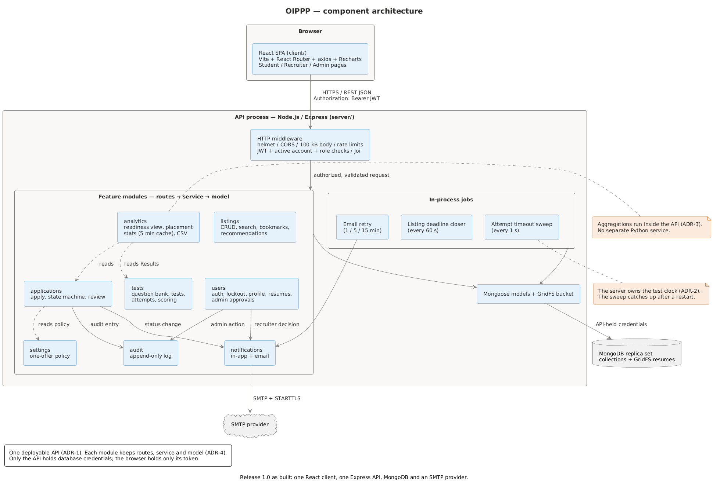

# OIPPP — Online Internship & Placement Preparation Portal

<p align="center">
  <a href="Sprint%201%20Demo.mp4">
    
  </a>
  <br>
  <sub>▶ <b><a href="Sprint%201%20Demo.mp4">Watch the Sprint 1 demo</a></b> (74 s): board, issues, PRs, CI and the live API</sub>
</p>

> Software Engineering project — PES University, Dept. of Computer Science and Engineering
> **Status:** release 1.0 is complete. The React client and the Express API cover all four feature areas: identity, profiles and admin; listings; applications and notifications; aptitude tests and analytics.

Campus placement is currently split across two disconnected halves: students hunt for internships on
scattered notice boards and mail threads, and practise for aptitude rounds on unrelated third-party
sites. Nobody — student or placement officer — can see whether a candidate is actually ready for the
roles they are applying to.

OIPPP puts both halves behind one login, so preparation history and application history inform each
other.

## What each role can do

| Role | Capabilities |
|:-----|:-------------|
| Student | Register with an SRN; keep a profile and one PDF resume; search, filter, sort and bookmark listings; see skill-matched recommendations; apply once per listing and track every status change; take timed aptitude tests that survive a refresh; see score trends, weakest topics and application counts |
| Recruiter | Register and wait for approval; post, edit and close listings; review applicants and their resumes; move applications through Applied → Shortlisted → Interview → Offer / Rejected, with a reason on rejection |
| Placement Admin | Approve or reject recruiters and disable accounts; turn the one-offer policy on or off; build the question bank and tests; view placement statistics by branch and graduation year; export the report as CSV |

Everyone gets in-app notifications, and status changes are also emailed. The full itemized feature list (F1–F16) is in [docs/PROPOSAL.md](docs/PROPOSAL.md#34-functional-features).

## Architecture

A React single-page client talks to one Node.js/Express API over REST. The API is a layered modular monolith: one folder per feature, each with routes, service and model. MongoDB holds all data, and resumes are stored in GridFS. Three jobs run inside the API process: the aptitude timeout sweep, the listing deadline closer and the email retry.



The reasons behind the main choices are in the [architecture decision records](docs/adr/README.md). The [diagram guide](docs/other-docs/diagrams/README.md) has the ER, use-case and sequence views.

| Layer | Choice |
|:------|:-------|
| Client | React 18, Vite 8, React Router 7, axios, Recharts (Node 20.19+) |
| API | Node.js 20, Express 4, Mongoose 8, Joi, jsonwebtoken, bcrypt, multer, helmet, express-rate-limit, pino, Nodemailer |
| Database | MongoDB 7 replica set (Atlas in production); GridFS for resumes |
| Analytics | MongoDB aggregations inside the API ([ADR-3](docs/adr/ADR-3-analytics-in-node-api.md)) |
| Testing | Jest, Supertest and mongodb-memory-server (server); Vitest and Testing Library (client); Postman/Newman (API); a load-test script |
| Tooling | GitHub Actions CI, ESLint, Python 3 for the documentation check |

## Repository layout

```
OIPPP/
├── README.md                  you are here
├── .github/                   CI, PR automation and the PR template
├── client/                    React + Vite single-page app — src/pages, src/components, src/api
├── server/                    Node.js + Express API — src/, tests/, scripts/
└── docs/
    ├── Part-1_Deliverables/   submitted SRS, SAD and Test Plan (PDF)
    ├── adr/                   architecture decision records
    ├── other-docs/            SRS map, API references, schemas, diagrams, deviations log, deployment
    ├── testing/               Postman collection and test reports
    └── sprints/               sprint completion and workload charts
```

Only the submitted deliverables in `docs/Part-*_Deliverables/` are committed as PDFs. Course-supplied
templates and guidelines are listed in `.gitignore` — pull them from the course page if you don't
have them.

## Getting started

You need **Node.js 20+** and a MongoDB **replica set** (Atlas, or the
[local Docker one-liner](docs/other-docs/aptitude-api.md#run-and-verify)): aptitude submissions use
transactions, and the server refuses to start on a standalone MongoDB.

**API** (terminal 1):

```sh
cd server
npm ci
cp .env.example .env   # set MONGO_URI, JWT_SECRET and the ADMIN_* values
npm run seed           # creates the first admin account
npm run seed:demo      # optional: sample recruiters, students, listings and tests
npm run dev            # http://localhost:5000/api/health
```

**Client** (terminal 2):

```sh
cd client
npm ci
npm run dev            # http://localhost:5173, proxies /api to port 5000
```

Sign in with the admin email and password from `server/.env`. For a deployed client, set
`VITE_API_URL` to the API's `/api` URL before `npm run build`.

## Testing

| Command | Where | What it runs |
|:--|:--|:--|
| `npm run lint` | `server/`, `client/` | ESLint, as in CI |
| `npm test` | `server/` | Jest unit and integration suites on an in-memory replica set; no database needed |
| `npm run test:coverage` | `server/` | The same suites with a coverage report (QA-4 target: 70% of statements) |
| `npm run test:api` | `server/` | The Postman collection through Newman, against a running API |
| `npm run test:load` | `server/` | Load test for PERF-1 and PERF-2 |
| `npm test` | `client/` | Vitest component tests |

The first server test run downloads a MongoDB binary. Results and the test summary are in
[docs/testing](docs/testing/).

## Deployment

The API runs as a Render web service and the client as a static site, with MongoDB Atlas. Steps,
environment variables and checks are in the [deployment guide](docs/other-docs/deployment.md).

## Documentation

| Document | Purpose |
|:---------|:--------|
| [docs/PROPOSAL.md](docs/PROPOSAL.md) | Project proposal — title, team profile, description, functional features, plan of work, product ownership. |
| [Architecture decision records](docs/adr/README.md) | Why the system is built the way it is: monolith, server timer, analytics in the API, no controller layer, resume storage. |
| [Architecture and diagrams](docs/other-docs/diagrams/README.md) | Component, ER, use-case and sequence views; editable PlantUML, rendered PNGs and the render script. |
| [API contract (S5)](docs/other-docs/api-contract.md) | Every route, role, payload and error code across all four modules; the client builds against this. |
| [docs/other-docs/SRS.md](docs/other-docs/SRS.md) | Map from the submitted SRS to the editable sections, with acceptance criteria and traceability. |
| [Identity and security SRS sections](docs/other-docs/identity-security.md) | Member 1 sections 2.3, 5.1 and 6.4 (task 1.8): requirement-by-requirement status and acceptance criteria. |
| [Applications and notifications](docs/other-docs/applications-api.md) | Applications, recruiter review and notifications: endpoints, state machine, collections. |
| [Aptitude authoring and attempts](docs/other-docs/aptitude-api.md) | Endpoints, replica-set MongoDB setup, scoring, save/recovery verification and what the client must do (tasks 4.1/4.2/4.3/4.5). |
| [Progress and analytics](docs/other-docs/analytics-api.md) | Student readiness, admin placement statistics and CSV export endpoints, plus the weak-topic and cohort rules (task 4.4). |
| [Aptitude database schema](docs/other-docs/database/aptitude-schema.md) | Question, Test, Attempt and Result models, indexes, lifecycle rules and schema tests (task 4.6). |
| [Deployment guide](docs/other-docs/deployment.md) | Hosting setup, environment variables and post-deploy checks. |
| [Test summary report](docs/testing/test-report.md) | Results for every test case and SRS ID, defects found, and the Postman collection and load test in [docs/testing](docs/testing/). |
| [docs/other-docs/DEVIATIONS.md](docs/other-docs/DEVIATIONS.md) | Deviations from the submitted SRS / SAD / Test Plan, to be explained at the final demo. |

Before changing a shared schema or route, read the [Working agreement](#working-agreement) and the
[API contract](docs/other-docs/api-contract.md).

## Team

Work is split by **functional feature**, not by layer, as the *Project Guidelines* require. Each
member owns their features end to end (UI, database, tests, docs) and reviews everyone else's.
Live task status is tracked in the [GitHub issues](https://github.com/Online-Internship-Placement-Prep-Portal/OIPPP/issues)
and on the [project board](https://github.com/orgs/Online-Internship-Placement-Prep-Portal/projects/2).

| # | Name | SRN | GitHub | Feature area |
|:-:|:-----|:----|:-------|:-------------|
| 1 | Deekshith Gowda G | PES1UG24CS142 | [@deekshithgowdag](https://github.com/deekshithgowdag) | Identity, Profiles & Admin |
| 2 | Sharath HG | PES1UG25CS844 | [@Sharathhg123](https://github.com/Sharathhg123) | Internship Listings & Discovery |
| 3 | Guru R Bharadwaj | PES1UG24CS177 | [@guru-bharadwaj20](https://github.com/guru-bharadwaj20) | Applications & Recruiter Workflow |
| 4 | E S Sukruth | PES1UG25CS160 | [@SUKRUTH-ES](https://github.com/SUKRUTH-ES) | Aptitude Tests, Progress & Analytics |

### Work division

Task numbers (e.g. 3.8) match the issue titles and are cited in [docs/other-docs/DEVIATIONS.md](docs/other-docs/DEVIATIONS.md).

**Member 1 — [Deekshith Gowda G](https://github.com/deekshithgowdag): Identity, Profiles & Admin**

| # | Task | Type |
|:-:|:-----|:-----|
| 1.1 | Student / Recruiter / Admin registration & login (JWT sessions) | Functional |
| 1.2 | Role-based access control across every protected route | Functional |
| 1.3 | Student profile management — education, skills, resume upload | Functional |
| 1.4 | Admin user management — approve recruiters, deactivate accounts | Functional |
| 1.5 | **Qualitative:** confidentiality — hashed passwords, no cross-role data leakage, resume files reachable only by owner + applied recruiter | Non-functional |
| 1.6 | User / Profile / Role schema design in MongoDB | Supporting |
| 1.7 | Unit + integration tests for owned features | Supporting |
| 1.8 | SRS sections: 2.3 User Classes, 5.1 Auth feature, 6.4 Security | Documentation |

**Member 2 — [Sharath HG](https://github.com/Sharathhg123): Internship Listings & Discovery**

| # | Task | Type |
|:-:|:-----|:-----|
| 2.1 | Recruiter posts / edits / closes an internship listing | Functional |
| 2.2 | Search, filter & sort listings (role, location, stipend, skills, deadline) | Functional |
| 2.3 | Bookmarks / saved internships + automatic deadline expiry | Functional |
| 2.4 | Skill-match recommendation of listings on the student home feed | Functional |
| 2.5 | **Qualitative:** performance — filtered search returns in < 2 s over a seeded set of 5,000+ listings (indexing + pagination) | Non-functional |
| 2.6 | Internship / Company schema design in MongoDB | Supporting |
| 2.7 | Unit + integration tests for owned features | Supporting |
| 2.8 | SRS sections: 2.2 Product Functions, 5.2 Listings feature, 6.1 Performance | Documentation |

**Member 3 — [Guru R Bharadwaj](https://github.com/guru-bharadwaj20): Applications & Recruiter Workflow**

| # | Task | Type |
|:-:|:-----|:-----|
| 3.1 | Student applies to an internship (resume + cover note, duplicate-safe) | Functional |
| 3.2 | Application status lifecycle — Applied → Shortlisted → Interview → Offer / Rejected | Functional |
| 3.3 | Recruiter application review — view applicants, shortlist, reject with reason | Functional |
| 3.4 | Notifications on every status change (in-app + email) | Functional |
| 3.5 | **Qualitative:** reliability — no lost or duplicated applications; every status transition is validated and audit-logged | Non-functional |
| 3.6 | Application / Notification schema design in MongoDB | Supporting |
| 3.7 | Unit + integration tests for owned features | Supporting |
| 3.8 | SRS sections: 5.3 Applications feature, 6.5 Business Rules, Appendix C traceability | Documentation |

**Member 4 — [E S Sukruth](https://github.com/SUKRUTH-ES): Aptitude Tests, Progress & Analytics**

| # | Task | Type |
|:-:|:-----|:-----|
| 4.1 | Question bank + admin-authored aptitude / technical test creation — [backend APIs](docs/other-docs/aptitude-api.md) | Functional |
| 4.2 | Timed test attempt with auto-save and single-attempt enforcement — [backend APIs + recovery](docs/other-docs/aptitude-api.md) | Functional |
| 4.3 | Auto-evaluation, scoring and per-topic result breakdown — [scoring](docs/other-docs/aptitude-api.md#auto-evaluation-and-per-topic-breakdown--task-43-tst-6) | Functional |
| 4.4 | Progress tracking + analytics dashboards (student readiness, admin placement stats) — [backend APIs](docs/other-docs/analytics-api.md) | Functional |
| 4.5 | **Qualitative:** usability & fairness — an in-progress test survives a refresh or a dropped connection without losing answers or clock state — [verification](docs/other-docs/aptitude-api.md#refresh-and-dropped-connection-verification--task-45-safe-1) | Non-functional |
| 4.6 | Question / Attempt / Result schema design in MongoDB — [design + models](docs/other-docs/database/aptitude-schema.md) | Supporting |
| 4.7 | Unit + integration tests for owned features | Supporting |
| 4.8 | SRS sections: 5.4 Aptitude, 5.5 Analytics, 6.3 Quality — [sections + traceability](docs/other-docs/aptitude-analytics-quality.md) | Documentation |

### Shared deliverables

One owner each; everyone reviews all of them.

| # | Deliverable | Owner |
|:-:|:------------|:------|
| S1 | Project proposal — `docs/PROPOSAL.md` → PDF | [@deekshithgowdag](https://github.com/deekshithgowdag) |
| S2 | SRS document — `docs/other-docs/SRS.md` → PDF | [@Sharathhg123](https://github.com/Sharathhg123) |
| S3 | Repo setup, branching rules, CI, `.env.example` | [@guru-bharadwaj20](https://github.com/guru-bharadwaj20) |
| S4 | Architecture & ER / use-case diagrams — [sources and guide](docs/other-docs/diagrams/README.md), [ADRs](docs/adr/README.md) | [@SUKRUTH-ES](https://github.com/SUKRUTH-ES) |
| S5 | API contract — shared route + payload spec agreed by all four | All |
| S6 | Final demo & presentation | All |

## Working agreement

**Branches**

```
main                    release branch, fast-forwarded to dev by the maintainer
dev                     integration branch — every feature PR targets this
feat/<area>-<summary>   e.g. feat/listings-search-filter
fix/<area>-<summary>
docs/<summary>
```

**Commits** — `<type>(<scope>): <summary>`, e.g. `feat(applications): add shortlist endpoint`.
Types: `feat`, `fix`, `docs`, `test`, `refactor`, `chore`, `ci`.

**Pull requests**

1. Branch off `dev`; never commit directly to `main` or `dev`.
2. Target `dev` — never another feature branch.
3. One issue per PR, with `Closes #<issue>` in the description.
4. A teammate approves and **merges**; never merge your own PR.

**Ground rules**

- Never commit `.env`, credentials, `node_modules/`, or the reference PDFs (see `.gitignore`).
- Anything touching a shared schema or the API contract gets discussed with all four members first.
- If you are blocked for more than a day, say so — reassignment is cheaper than a stalled milestone.
