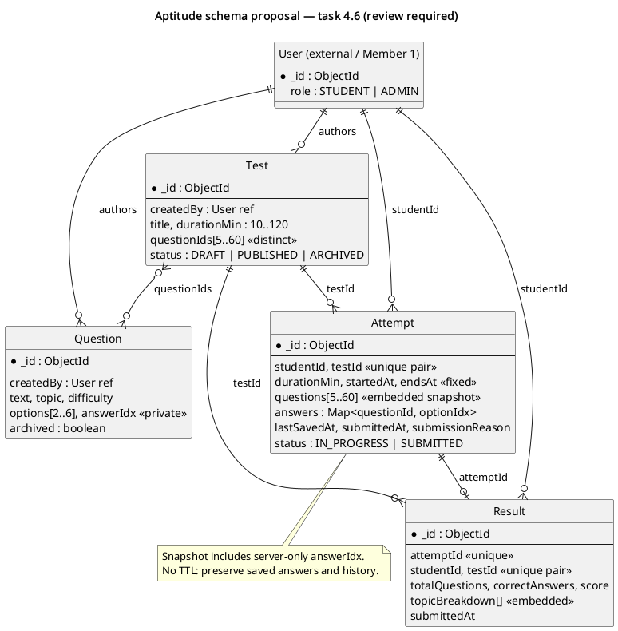

# Aptitude database schema — task 4.6 / issue #30

**State:** merged; the aptitude services and timeout worker use these models.  
**Owner:** E S Sukruth (Member 4).  
**Sprint:** existing Sprint 1. Scope is database design and model validation only.

## Sources and scope

The delivered [SRS](../../Part-1_Deliverables/SRS.pdf), section 4.7 (TST-1–TST-6), section 4.8 (ANL-1–ANL-2), and SAFE-1/SAFE-2 are authoritative. The delivered [SAD](../../Part-1_Deliverables/SAD.pdf), sections 4.1 and 4.3.4, places this module under `server/src/modules/tests/` and defines `text`, `options`, `answerIdx`, `durationMin`, and `questionIds`.

This covers the Question, Attempt and Result models plus the supporting Test model needed to identify a test and enforce TST-2. The endpoints, attempt services, scoring and timeout worker built on them are described in [aptitude-api.md](../aptitude-api.md). No connection is opened on model import.

## Collections and relationships



[Editable PlantUML source](aptitude-er.puml). This scoped proposal supplements, rather than silently replaces, the existing project-wide ER diagram.

All records have MongoDB `_id`, Mongoose `createdAt`, `updatedAt`, and version key `__v`. Models use document-level optimistic concurrency. The model names/collections are `Question`/`questions`, `Test`/`tests`, `Attempt`/`attempts`, and `Result`/`results`.

| Model | Main fields | Rules |
| --- | --- | --- |
| Question | `text`, `topic`, `difficulty`, `options[]`, `answerIdx`, `createdBy`, `archived` | 2–6 distinct nonempty options, exactly one zero-based answer index within the options; text ≤4,000 characters, each option ≤1,000. Topic is Quantitative, Logical, Verbal or Technical. |
| Test | `title`, `durationMin`, `questionIds[]`, `createdBy`, `status` | 5–60 distinct question IDs; integer duration 10–120 minutes; title ≤200 characters; DRAFT/PUBLISHED/ARCHIVED. |
| Attempt | `studentId`, `testId`, `durationMin`, `startedAt`, `endsAt`, `questions[]`, `answers`, `lastSavedAt`, `status`, `submittedAt`, `submissionReason` | One record per student/test; snapshot of 5–60 distinct questions with their server-only answer keys; IN_PROGRESS or SUBMITTED; submission reason MANUAL or TIMEOUT. |
| Result | `attemptId`, `studentId`, `testId`, `totalQuestions`, `correctAnswers`, `score`, `topicBreakdown[]`, `submittedAt` | One result per attempt and per student/test; score and topic percentages must match counts; topic counts must sum to the overall counts. |

Relationships: User → many authored Questions/Tests and student Attempts/Results; Test → many Questions; Test → many Attempts; Attempt → zero or one Result. `User` is the existing auth middleware's expected model name, not a new User implementation. MongoDB references are not foreign keys: services must verify referenced records, roles, and ownership.

### Example field shapes

```js
// Question (answerIdx is server-only; excluded from ordinary queries and JSON)
{ text: 'What is 2 + 2?', topic: 'Quantitative', difficulty: 'Easy',
  options: ['3', '4'], answerIdx: 1, createdBy: adminId, archived: false }

// Test (IDs are ObjectIds, not arbitrary client strings)
{ title: 'Placement practice', durationMin: 30,
  questionIds: [q1, q2, q3, q4, q5], createdBy: adminId, status: 'DRAFT' }

// Snapshot entry embedded in Attempt.questions (includes answerIdx only on server)
{ questionId: q1, text: 'What is 2 + 2?', topic: 'Quantitative',
  difficulty: 'Easy', options: ['3', '4'], answerIdx: 1 }

// Attempt.answers is a Mongoose Map; omitted key = unanswered, 0 is a real answer
{ [q1.toString()]: 1, [q2.toString()]: 0 }

// Result example — score is a percentage, not a count
{ attemptId, studentId, testId, totalQuestions: 5, correctAnswers: 4, score: 80,
  submittedAt: serverSubmissionTime,
  topicBreakdown: [{ topic: 'Quantitative', totalQuestions: 5,
    correctAnswers: 4, percentage: 80 }] }
```

Conventions (decision D3): difficulty values Easy/Medium/Hard; equal weight of one point per question, no negative marking; store full-precision percentage and round only for display; use a separate Result collection as the canonical score rather than duplicate `Attempt.score` from the old high-level ER diagram. Topics absent from a test are omitted from its breakdown, not assigned 0%.

## Indexes

| Collection | Index | Purpose |
| --- | --- | --- |
| questions | `{ topic: 1, difficulty: 1, archived: 1 }` | Question bank filtering. |
| tests | `{ status: 1, createdAt: -1 }` | Published test listing. |
| attempts | **unique** `{ studentId: 1, testId: 1 }` | Race-safe single-attempt enforcement (TST-3). |
| attempts | `{ status: 1, endsAt: 1 }` | Find overdue active attempts for the timeout worker. |
| results | **unique** `{ attemptId: 1 }` | Idempotent result creation. |
| results | **unique** `{ studentId: 1, testId: 1 }` | No second scoring record for the same student/test. |
| results | `{ studentId: 1, submittedAt: -1 }` | Personal score trends. |
| results | `{ testId: 1, submittedAt: -1 }` | Per-test reporting. |

No TTL index: expiring an attempt must never delete saved answers or placement history (SAFE-1/SAFE-2). Branch/year analytics joins Result.studentId to the current Profile (decision D4); no branch/year copy is stored here.

## Attempt lifecycle and service obligations

1. **Start/resume:** authenticate an active student, load a PUBLISHED Test, check all Questions exist and are usable, explicitly fetch `+answerIdx`, and create a self-contained question snapshot. Set `startedAt` from the server and `endsAt = startedAt + durationMin × 60,000`; neither value comes from the browser. The snapshot's duration and deadline do not change when the bank or Test changes. On duplicate key error 11000, reload the existing student/test Attempt: return it if active, otherwise return ATTEMPT_EXISTS. Do not create a replacement attempt.
2. **Read:** use `attempt.toStudentView()` for the documented attempt payload. Never return hydrated scoring documents, `lean()` results selected with answer keys, or a raw aggregation. Question.answerIdx and snapshot answerIdx have `select: false`, and JSON serialization also strips the keys, but these are defense in depth rather than authorization. Admin reads/writes need their own explicit DTO.
3. **Save:** verify ownership, status, question membership, option index and deadline on the server. Persist every selection, including index 0. Missing answer keys remain unanswered. Return success only after MongoDB acknowledges the write. Never replace the entire answers map from a stale browser copy. Target ≤1 second per TST-4; model tests do not measure this API/network target.
4. **Concurrency:** the tested document-save path uses `.save()` with optimistic concurrency; a VersionError must cause reload/revalidation/retry or a conflict response, not an overwrite. Future atomic update paths must explicitly filter on status, owner, deadline and expected version, increment `__v`, and handle no-match conflicts. Mongoose `runValidators` on a partial query update does **not** run the document-wide pre-validate invariants. Do not expose unrestricted query updates, replacement writes, bulk writes, or a generic model CRUD API.
5. **Timeout:** a server worker must finalize overdue active attempts using the indexed deadline. A browser refresh or disconnect does not pause the timer. TST-5 says auto-submit at endsAt and reject answers received beyond endsAt + 30 seconds. The team chose a hard cutoff at endsAt (decision D1), and a submitted attempt is never reopened. The schemas only store timing state; `attempt-timeout.job.js` does the scheduling.
6. **Submit/score:** load the snapshotted answer keys with `+questions.answerIdx`, evaluate server-side, then atomically transition IN_PROGRESS → SUBMITTED and insert the canonical Result. Use a MongoDB transaction on an Atlas/replica-set deployment, or an explicitly designed retry/recovery protocol. Score/result consistency across collections is a service responsibility, not a schema guarantee. Repeated submissions must return the existing result, never score twice. The client cannot supply score, answer keys, timestamps, studentId, or result totals.
7. **Retention:** archive questions/tests rather than hard-delete them in normal admin flows; do not cascade-delete attempts/results when an account is disabled. Snapshots protect historical meaning even if a question is later edited.

## Validation and verification

Models live under `server/src/modules/tests/` and follow CommonJS/Mongoose 8 conventions. Full-document validation covers question bounds, test bounds, valid answer membership, duplicate snapshot IDs, deadline arithmetic, submission metadata, and internally consistent results. Identity, publishing, cross-record existence, immutable workflow transitions, timer scheduling and request authorization remain service-level work. Mongoose immutability is not a database permission boundary.

From `server/` with Node 20+ and the declared dependencies installed:

```sh
npm ci
npm test -- --testPathPattern=aptitude
```

The integration suite uses `mongodb-memory-server`; the first run may download a MongoDB binary and needs network access plus a writable cache. No real MongoDB URI or credentials are needed. Before rollout, create/verify the declared unique indexes before accepting writes; if collections already contain data, inspect and reconcile duplicates first, without deleting student history. Do not run `syncIndexes()` indiscriminately against a shared database.

`tests/unit/aptitude-models.test.js` covers positive, negative and boundary cases. `tests/integration/aptitude-indexes.test.js` uses a temporary MongoDB to verify concurrent duplicate starts, duplicate results, persisted answer/deadline recovery, private answer-key selection, snapshot independence and stale-save conflicts.

## Review status

The User reference, Test lifecycle, separate Result and score conventions (D3), the TST-5 cutoff (D1) and the transactional submit were agreed and merged with #30 and the aptitude service PRs.
